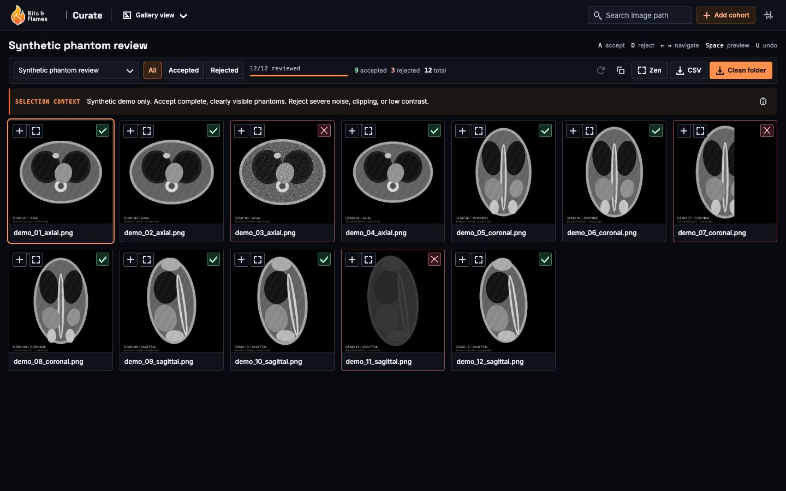

# Fyron Curate

**A local workspace for reviewing images and selecting research datasets.**

Curate helps you accept or reject images, keep selection criteria visible, and export reviewed labels or selected files. It runs through Docker Compose, saves review state in PostgreSQL, and preserves uploaded originals. It is a beta research application, not a diagnostic viewer.

## Choose a guide

| Guide | What you will learn |
| --- | --- |
| [Start the app](curate/start.md) | Install, launch, troubleshoot, and restart without losing data. |
| [Prepare your data](curate/prepare-data.md) | Supported formats, folder layouts, and Bash/Python preview preparation. |
| [Review & export](curate/review-export.md) | Gallery and Zen review, decisions, CSV labels, and clean-folder exports. |

## Explore Curate With Example Data

The gallery below shows a real Curate session with **12 synthetic image phantoms**: nine accepted samples and three rejected examples with severe noise, clipping, or low contrast. The images are generated from geometric shapes; they contain no patient data and are intended only to demonstrate the review workflow.

<em>The compact gallery keeps selection context, review progress, filters, and export actions alongside the images. Pixel status icons mark decisions without dimming the previews.</em>

[Open the full-size gallery screenshot](../assets/curate-synthetic-gallery.png) · [Download the example images (ZIP, 1.1 MB)](../assets/curate-demo-images.zip)

### Try The Example Cohort

1. [Install and start Curate](#install), then unzip the example download.
2. Choose **Add cohort**, name it **Synthetic phantom review**, and drop the extracted `images/` folder into the upload area.
3. Add this selection context: **Synthetic demo only. Accept complete, clearly visible phantoms. Reject severe noise, clipping, or low contrast.**
4. Review all 12 images with `A` to accept or `D` to reject. The screenshots reject `demo_03_axial.png`, `demo_07_coronal.png`, and `demo_11_sagittal.png`; these are illustrative choices, not clinical quality thresholds.
5. Use **CSV** to export the reviewed labels or **Clean folder** to copy the accepted originals.

New images initially appear accepted. Confirm each decision explicitly before exporting CSV labels. The download includes a README, the image generator, and a license so the example can be reproduced.

## Local Use And Uploads

Curate binds its app ports to loopback and is intended for local use. See [startup and storage](curate/start.md) and [upload limits and retries](curate/prepare-data.md#upload-limits-and-retries).

## Gallery View For Easy Selection

Use the gallery for an overview and Zen mode for focused review. Selection context, filters, and fit settings help keep decisions consistent. See [Review & export](curate/review-export.md).

## Install

Install Python 3.11+, Fyron, and a running Docker Compose runtime. Follow [Start the app](curate/start.md#install).

## Start Curate

Run `uv run fyron curate --open` from your project, then open `http://localhost:5174/`. See [startup options](curate/start.md#startup-options).

## Review Workflow

Create a cohort, upload a complete folder, explicitly review every image, and choose CSV or clean-folder export. Their review requirements differ; see [Choose an export](curate/review-export.md#choose-an-export).

### Focused Review In Zen Mode

See [Zen mode and its screenshot](curate/review-export.md#focused-review-in-zen-mode) for one-image-at-a-time review.

## Data You Can Drop Into Curate

Ordinary raster images and readable DICOM series can be uploaded directly. NIfTI and other volumes need previews. See the [format table and folder examples](curate/prepare-data.md#accepted-uploads-and-preview-limits).

## CT, MRI, X-Ray, And Topogram Data

Prepare PNGs with `fyron dataset-curate-previews` or `prepare_curate_image_previews`. See [Bash and Python examples](curate/prepare-data.md#prepare-volume-previews-with-fyron), including windowing, manifests, and the limits of middle-slice review.

## Persistent Data

Review metadata, uploaded originals, and clean exports live in persistent Docker volumes. See [Stop and restart safely](curate/start.md#stop-and-restart-safely).

## Citation

If Fyron contributes to your paper, thesis, or other scientific work, please cite it. This includes using Fyron Curate for image review, dataset selection, or cohort screening, even when downstream analysis uses other software.

Curate is part of Fyron. Use the [Fyron software citation and BibTeX](../index.md#citation), with authors René Hosch, Katarzyna Borys, Sina Warmer, Jannis Straus, Kamyar Hartmann, and Justin Woolley, rather than inventing a separate Curate publication. Record the Fyron version actually used.

A reusable Methods sentence:

Images were reviewed and selected using Fyron Curate (Fyron version X.Y.Z).

Replace X.Y.Z with your installed version and report the study's selection criteria, who performed the review, and how accepted/rejected decisions were used. Adapt the sentence to describe what you actually did; citing the tool does not replace documenting the selection process.

Citation is a scholarly request, not an additional license condition.

## Related Pages

- [Start the app](curate/start.md)
- [Prepare your data](curate/prepare-data.md)
- [Review & export](curate/review-export.md)
- [Using Fyron in Research](../repository-trust.md)

## License

Current Curate source, including its frontend and backend, is available under
**CC BY-NC 4.0** for noncommercial use with attribution. Share the license link
and indicate changes when redistributing or adapting the material. Commercial
use beyond existing permissions requires separate permission from the rights holder.
See the [license](https://github.com/BitsandFlames/Fyron/blob/main/LICENSE).

Previously published MIT versions, including Beta 3, retain their MIT permissions.
Third-party components retain their own licenses and notices.
