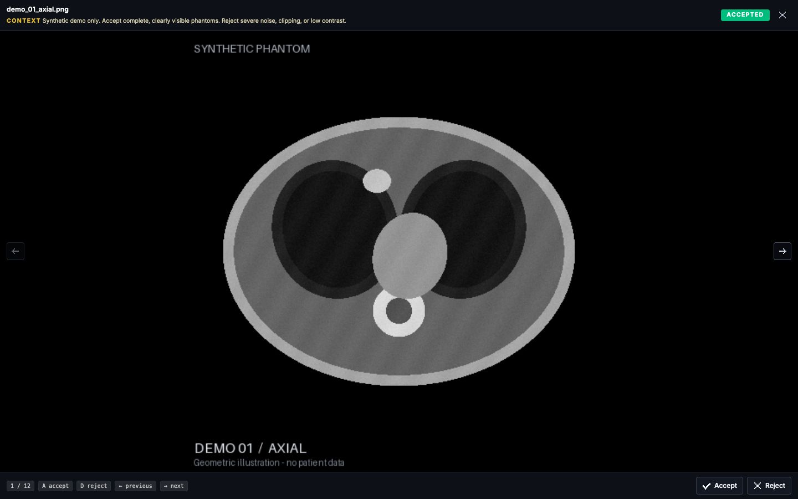

# Review and Export in Curate

Start with a complete upload and clear selection criteria. Curate saves decisions while preserving uploaded originals.

## Create and review a cohort

1. Choose **Add cohort**, give it a name, and select or drop your prepared folder.
2. Add a **Selection context** describing what to accept and reject.
3. Wait for every upload batch to finish. Retry failed batches before reviewing or exporting.
4. Review images in the gallery or open **Zen** for one image at a time.
5. Explicitly accept or reject each image, then export the result you need.

**New images initially appear accepted, but this is not an explicit review decision.** Confirm an accepted image with `A` or the accept control rather than relying on its initial appearance. Clicking a tile toggles its current accepted/rejected state.

Search, status filters, thumbnail size, and spacing help navigate larger cohorts. Choose **Gallery settings → Image fit → Fit** to see the whole image, or **Crop** for filled thumbnails. Selection context stays visible in the gallery and Zen mode and can be edited later.

## Shortcuts and corrections

| Key | Action |
| --- | --- |
| `A` | Accept the current image |
| `D` | Reject the current image |
| Left / right arrow | Previous / next image |
| `Esc` | Close preview or Zen mode |

Use **Undo** to restore a recent decision in the current session, or select the image and set its state again. Saved review states persist across restarts; the in-memory undo history does not.

## Focused review in Zen mode



Zen keeps the current image, decision, selection criteria, and navigation together. [Open the full-size screenshot](../../assets/curate-synthetic-zen.png).

For direct DICOM imports, the app shows study cards with one thumbnail per series. Accepting or rejecting a series determines whether its source instances are included in a clean export.

## Choose an export

| Export | What it contains | Required review state |
| --- | --- | --- |
| **CSV** | `filename,status`, with relative paths and lowercase `accepted` or `rejected` values | Every image must have an explicit review event; empty cohorts and incomplete uploads are rejected. |
| **Clean folder** | Copies of currently accepted files, preserving relative paths; selected direct-import DICOM series also appear under `dicom_series/` | Upload must be complete. It does **not** require every image to have been explicitly reviewed. |

Because clean export uses the current state, initially accepted but unreviewed images can be included. Finish reviewing the full cohort before treating a clean export as a reviewed dataset. Neither a filter nor the visible gallery subset changes the export into a subset-only operation.

CSV exports download through the browser. For DICOM, CSV labels refer to the review images/series thumbnails; the clean export carries the selected original series files. Damaged or incomplete DICOM metadata prevents a clean series export.

## Locate exported files

**Clean folder** writes to the backend's persistent export volume, not directly to the source directory on your host. The app reports the export path, under `/data/exports/<cohort-id>/<export-id>/` in the backend container.

To copy the export directory to your machine, resolve the same app directory used at startup and choose a new local destination:

```bash
CURATE_APP_DIR="$(uv run python -c 'from fyron.curate import default_app_dir; print(default_app_dir())')"
docker compose --project-directory "$CURATE_APP_DIR" cp \
  backend:/data/exports ./curate-export-copy
```

This copies all exports in that project. For a specific export, replace `/data/exports` with the path reported by Curate. If you used `--app-dir`, use that directory here too. Keep exported files under your study's data controls.

Original source files and uploaded copies remain unchanged. Correct a decision and create a new export when needed; an earlier export is a snapshot and does not update automatically.

## PNG previews versus source volumes

When you uploaded generated PNG previews, clean export contains PNGs. Use the preview manifest and a documented aggregation rule to map review decisions back to the original volumes. See [Prepare your data](prepare-data.md#understand-what-a-preview-decision-means).

[Storage and restart](start.md#stop-and-restart-safely) · [Citation guidance](../curate.md#citation)
