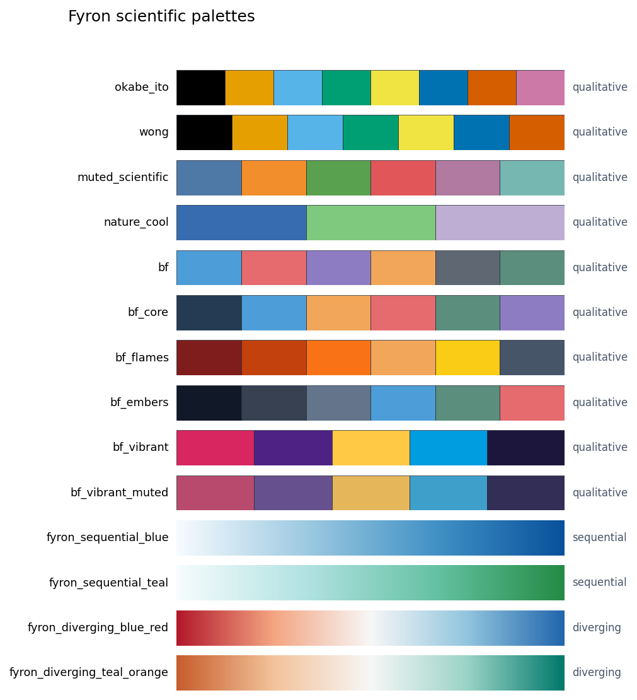

# Colors And Styles

Fyron plotting uses a small scientific color system for publication figures. The default categorical palette is colorblind-safe, while Bits & Flames colors remain available for branded figures.

Use this page when choosing palettes, figure styles, or grayscale-safe outputs. For full plotting workflows, see [Clinical Plotting](modules/plotting.md).

## Public APIs

```python
from fyron import plotting as fp

fp.list_palettes()
fp.get_palette("okabe_ito")
fp.get_colormap("fyron_diverging_blue_red")
fp.set_plot_style(style="paper", palette="okabe_ito")
fp.preview_palette("okabe_ito")
fp.palette_luminance_table("okabe_ito")
fp.palette_grayscale_contrast("okabe_ito")
```

## Palette Families

| Family | Use |
| --- | --- |
| qualitative | categories such as treatment arm, risk group, sex, scanner, or cohort |
| sequential | ordered magnitude such as risk score, density, or intensity |
| diverging | centered quantities such as correlations, residuals, and difference maps |

## Built-In Names

| Name | Type | Recommended use | Colorblind-safe |
| --- | --- | --- | --- |
| `okabe_ito` | qualitative | default categorical palette for treatment arms, risk groups, and cohorts | yes |
| `wong` | qualitative | compact categorical palette for up to seven groups | yes |
| `muted_scientific` | qualitative | softer manuscript palette for journals and slides | no |
| `nature_cool` | qualitative | restrained two-to-three group comparison palette | no |
| `bf` | qualitative | Bits & Flames / BOARISK continuity | no |
| `bf_core` | qualitative | balanced Bits & Flames palette for branded clinical dashboards and slide figures | no |
| `bf_flames` | qualitative | warm Bits & Flames palette for highlights, emphasis, and presentation figures | no |
| `bf_embers` | qualitative | cool ember-inspired Bits & Flames palette for quiet analytics figures | no |
| `bf_vibrant` | qualitative | high-contrast Bits & Flames palette for vibrant branded figures and presentation highlights | no |
| `bf_vibrant_muted` | qualitative | muted Bits & Flames vibrant palette for branded figures that need less saturation | no |
| `fyron_sequential_blue` | sequential | ordered magnitude maps, density, risk scores, intensity summaries | yes |
| `fyron_sequential_teal` | sequential | ordered magnitude maps with a cooler visual tone | yes |
| `fyron_diverging_blue_red` | diverging | correlations, residuals, and zero-centered difference maps | no |
| `fyron_diverging_teal_orange` | diverging | centered clinical quantities and signed changes | no |

## Palette Overview



## Palette Gallery

<div class="bf-figure-gallery">
<figure class="bf-figure-card">

<figcaption><strong>okabe_ito</strong>Default colorblind-safe qualitative palette. Use for the first pass of most categorical manuscript figures.</figcaption>
</figure>
<figure class="bf-figure-card">

<figcaption><strong>wong</strong>Compact scientific categorical palette for clear group separation with restrained colors.</figcaption>
</figure>
<figure class="bf-figure-card">

<figcaption><strong>muted_scientific</strong>Softer journal-style palette for descriptive figures, validation plots, and presentations.</figcaption>
</figure>
<figure class="bf-figure-card">

<figcaption><strong>nature_cool</strong>Cool, restrained palette for two or three clinical comparison groups.</figcaption>
</figure>
<figure class="bf-figure-card">

<figcaption><strong>bf</strong>Bits & Flames / BOARISK continuity palette for branded figures and project dashboards.</figcaption>
</figure>
<figure class="bf-figure-card">

<figcaption><strong>bf_core</strong>Balanced brand palette that mixes deep ink, Fyron blue, flame orange, coral, teal, and violet.</figcaption>
</figure>
<figure class="bf-figure-card">

<figcaption><strong>bf_flames</strong>Warm palette for branded emphasis, slide highlights, and visual storytelling around important findings.</figcaption>
</figure>
<figure class="bf-figure-card">

<figcaption><strong>bf_embers</strong>Quiet analytics palette with charcoal, slate, Fyron blue, teal, and coral accents.</figcaption>
</figure>
<figure class="bf-figure-card">

<figcaption><strong>bf_vibrant</strong>Vibrant brand palette with #D72660, #4E2284, #FFC845, #009DE0, and #1C163D.</figcaption>
</figure>
<figure class="bf-figure-card">

<figcaption><strong>bf_vibrant_muted</strong>Muted companion palette with #B84A6D, #66508D, #E6B65A, #3F9FCB, and #332E55.</figcaption>
</figure>
<figure class="bf-figure-card">

<figcaption><strong>fyron_sequential_blue</strong>Sequential blue colormap for ordered magnitude such as risk, density, or intensity.</figcaption>
</figure>
<figure class="bf-figure-card">

<figcaption><strong>fyron_sequential_teal</strong>Sequential teal colormap for ordered magnitude when a cooler palette fits the figure.</figcaption>
</figure>
<figure class="bf-figure-card">

<figcaption><strong>fyron_diverging_blue_red</strong>Diverging colormap for values centered on zero, such as correlations or CT/MR difference maps.</figcaption>
</figure>
<figure class="bf-figure-card">

<figcaption><strong>fyron_diverging_teal_orange</strong>Diverging colormap for signed clinical changes when teal/orange separation reads better than blue/red.</figcaption>
</figure>
</div>

## Reproducible Palette Audit

Use the API to generate the exact same previews in a notebook or paper-figure script:

```python
from fyron import plotting as fp

palettes = fp.list_palettes()
fig, ax = fp.preview_palette("okabe_ito")

luminance = fp.palette_luminance_table("okabe_ito")
contrast = fp.palette_grayscale_contrast("okabe_ito")
```

`list_palettes()` returns the palette name, family, number of colors, maximum recommended categorical colors, colorblind-safe flag, source note, and explicit hex values.

## Figure Style

```python
fp.set_plot_style("paper", palette="okabe_ito")
```

Use `palette="bf"`, `palette="bf_core"`, `palette="bf_flames"`, `palette="bf_embers"`, `palette="bf_vibrant"`, or `palette="bf_vibrant_muted"` when brand continuity matters. For manuscripts, prefer `okabe_ito` plus hatches, markers, direct labels, and small multiples when there are many groups.

## Checks Before Publication

- Preview the palette in the expected number of groups.
- Audit luminance when figures may be printed in grayscale.
- Use diverging colormaps only when zero or a midpoint has meaning.
- Avoid rainbow and jet palettes for scientific interpretation.
- Verify final exported figures in the target medium: PDF, SVG, slides, or grayscale print.

## Related Pages

- [Clinical Plotting](modules/plotting.md)
- [Manuscript Plotting Workflow](examples/manuscript-plotting-workflow.md)
- [Volume Difference Heatmap](examples/volume-difference-heatmap.md)
