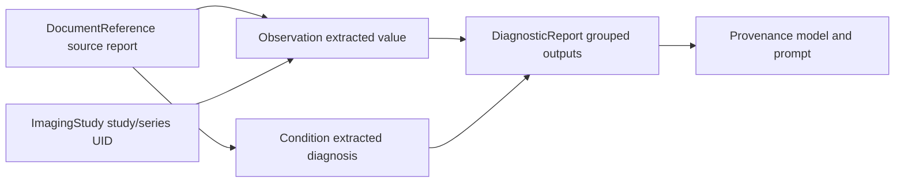

# FHIR Mapping

`fyron.fhir.mapping` turns clinical DataFrames into FHIR resources and bundles. It is the bridge from LLM extraction tables, BOA measurements, imaging features, and reviewed CSV outputs into inspectable FHIR JSON.

The mapping layer does not guess clinical meaning. You provide an explicit mapping dictionary or JSON file that names the DataFrame columns used for FHIR fields.

## When To Use It

| Situation | Use |
| --- | --- |
| A reviewed CSV contains extracted lab values or markers | `build_observations_from_dataframe` |
| A table contains extracted diagnoses or phenotype labels | `build_conditions_from_dataframe` |
| A table contains source reports or generated summaries | `build_document_references_from_dataframe` |
| BOA/radiomics/imaging measurements should point to study and series UIDs | `build_imaging_measurements_from_dataframe` |
| A CLI job should turn a CSV into a FHIR transaction bundle | `fyron fhir-build-bundle` |

## Bundle Graph



## Observation Mapping

```python
import pandas as pd
from fyron.fhir.mapping import build_observations_from_dataframe

df = pd.DataFrame(
    {
        "patient_id": ["123"],
        "observation_id": ["hgb-001"],
        "loinc_code": ["718-7"],
        "display": ["Hemoglobin"],
        "value": [13.4],
        "unit": ["g/dL"],
    }
)

mapping = {
    "code_col": "loinc_code",
    "code_display_col": "display",
    "code_system": "http://loinc.org",
    "value_col": "value",
    "unit_col": "unit",
}

result = build_observations_from_dataframe(
    df,
    mapping,
    subject_col="patient_id",
    id_col="observation_id",
    bundle_type="collection",
)

bundle = result["bundle"]
summary = result["summary"]
validation = result["validation"]
```

## Mapping JSON

```json
{
  "code_col": "loinc_code",
  "code_display_col": "display",
  "code_system": "http://loinc.org",
  "value_col": "value",
  "unit_col": "unit",
  "effective_col": "measurement_time",
  "profile": "https://example.org/fhir/StructureDefinition/lab-observation",
  "meta_source": "https://analysis.example.org/fyron/run-001"
}
```

Column mappings use the suffix `_col`. Constants use the plain key, for example `code_system` or `profile`.

## Validation Report

Every mapping result contains:

```python
{
    "bundle": bundle,
    "resources": resources,
    "summary": summary,
    "validation": validation,
}
```

`validation` follows this structure:

```json
{
  "valid": true,
  "errors": [],
  "warnings": [],
  "info": [],
  "resource_counts": {"Observation": 1},
  "missing_references": []
}
```

Fyron checks structure, required fields, coding-system presence, bundle requests, and generated local references. It does not perform full profile conformance validation.

## CLI Workflow

```bash
fyron fhir-build-bundle \
  --input extracted_observations.csv \
  --mapping observation_mapping.json \
  --resource Observation \
  --subject-col patient_id \
  --id-col observation_id \
  --bundle-type transaction \
  --transaction-method PUT \
  --output bundle.json \
  --summary-json bundle_summary.json \
  --validation-json validation_report.json
```

Submit directly only after local review:

```bash
fyron fhir-build-bundle \
  --input extracted_observations.csv \
  --mapping observation_mapping.json \
  --resource Observation \
  --subject-col patient_id \
  --bundle-type transaction \
  --output bundle.json \
  --submit \
  --base-url https://fhir.example.org/fhir
```

## Server Write-Back Checklist

- Build `collection` bundles first for local review.
- Inspect `summary` and `validation` before writing to a server.
- Use `transaction` bundles for server submission.
- Use `PUT` only when stable resource IDs are intentional.
- Validate against your implementation guide or server profile.
- Keep the input CSV, mapping JSON, bundle JSON, and validation report together for audit.

## Function Reference

| Function | Required inputs | Optional inputs | Returns |
| --- | --- | --- | --- |
| `build_observations_from_dataframe` | DataFrame, mapping, `subject_col` | `id_col`, bundle type, transaction method, version | mapping result dict |
| `build_conditions_from_dataframe` | DataFrame, mapping, `subject_col` | evidence mapping, status mappings, ids | mapping result dict |
| `build_document_references_from_dataframe` | DataFrame, mapping, `subject_col` | URL/title/content mappings | mapping result dict |
| `build_imaging_measurements_from_dataframe` | DataFrame, mapping, subject and study UID columns | series UID, ids, model metadata | mapping result dict |
| `build_bundle_from_dataframe` | DataFrame, resource type, mapping, subject column | dispatch options | mapping result dict |
| `validate_fhir_mapping` | mapping | DataFrame | validation report |
| `validate_fhir_payload` / `fhir_validation_report` | resource or bundle | strict mode | validation report |
| `extract_coding_summary` | resource or bundle | none | coding DataFrame |

## Related Modules

- [FHIR Builder](builder.md) for low-level resource builders.
- [FHIR](../../fhir/index.html) for REST query and submit helpers.
- [LLM](../../llm/index.html) for extraction workflows that produce reviewed tables.
- [BOA Extraction](../../boa-extraction/index.html) for imaging measurements that can be mapped to FHIR.
