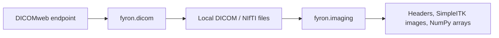

# Imaging

`fyron.imaging` contains local medical imaging helpers built around SimpleITK, NumPy, and pydicom. Use it after files are already on disk: DICOM headers, DICOM series, NIfTI volumes, and normalized arrays for modeling or visualization.

Use this module after files are already on disk. It handles the practical tasks that usually sit between PACS download and analysis: reading headers, discovering series, loading volumes, preserving geometry, and normalizing intensities. Keep these operations explicit so spatial orientation, voxel spacing, and intensity scaling are traceable.

For generated GAN volumes that should be written with synthetic DICOM identifiers, use [Synthetic DICOM/NIfTI export](dicom/synthetic.md). For segmentation masks that need valid DICOM SEG objects, use [DICOM SEG](dicom/seg.md). For visual comparison of two already-aligned CT/MR volumes, use [BOA Visualization](visualization.md#volume-difference-heatmaps).

CT window bounds and segmentation metric inputs must be finite. Missing mask values are rejected rather than counted as foreground.

## Choose an Imaging Task

Use the Imaging navigation for local I/O, normalization, geometry checks, and
segmentation metrics. Body and Organ Analysis has its own navigation group for
working with upstream BOA outputs.

| Task | Functions and guidance |
| --- | --- |
| Normalize CT intensities | [`normalize_ct`](#normalizect) for explicit HU clipping and scaling |
| Normalize MRI intensities | [`normalize_mr`](#normalizemr) for percentile, maximum, or fixed-value scaling |
| Inspect and load DICOM | [`read_dicom_header`](#readdicomheader), [`get_dicom_series_ids`](#getdicomseriesids), [`read_dicom_series`](#readdicomseries) |
| Read and write NIfTI | [`read_nifti`](#readnifti), [`write_nifti`](#writenifti) |
| Check geometry, masks, and intensities | [Imaging QC helpers](#imaging-qc-helpers) |
| Compare segmentation masks | [Segmentation metrics](#segmentation-metrics) |

## Relationship To DICOM Downloads

Use `fyron.dicom` to download from DICOMweb. Use `fyron.imaging` once files are local.

## Practical Imaging Notes

- DICOM series can be nested differently across PACS exports; inspect discovered series before loading.
- NumPy arrays follow image-library axis conventions, commonly `(z, y, x)`.
- CT normalization should use clinically meaningful HU windows.
- MR normalization is scanner/protocol dependent; review percentile choices before modeling.
- When writing NIfTI, pass a reference image when geometry matters.
- For difference heatmaps, resample or align volumes explicitly before plotting; the visualization helper validates geometry but does not resample.



## Imports

```python
from fyron import imaging as fim
```

## Function Summary

| Function | What it does | Typical return |
| --- | --- | --- |
| `read_dicom_header` | Read metadata from one DICOM file | `pydicom.Dataset` or `dict` |
| `get_dicom_series_ids` | Discover series IDs in a DICOM folder | `list[str]` or DataFrame |
| `read_dicom_series` | Load one DICOM series | `SimpleITK.Image` or `(image, array)` |
| `read_nifti` | Load a NIfTI file | `SimpleITK.Image` or `(image, array)` |
| `write_nifti` | Save image/array as NIfTI | `Path` |
| `normalize_ct` | Clip CT HU and scale to `[0, 1]` | same container type as input |
| `normalize_mr` | Normalize MR intensities | same container type as input |
| `summarize_dicom_series_geometry` | Summarize DICOM slice geometry and spacing | DataFrame |
| `summarize_nifti_geometry` | Summarize NIfTI shape, spacing, origin, direction | DataFrame |
| `check_image_mask_alignment` | Compare image and mask geometry | dict |
| `summarize_mask_volume` | Count mask voxels and volume in ml | DataFrame |
| `summarize_intensity_range` | Summarize min/max/mean/percentile intensities | dict |
| `dice_score` | Dice overlap for binary masks or one label | float |
| `hausdorff_distance` | Symmetric Hausdorff distance between mask surfaces | float |
| `surface_dice` | Surface Dice at a tolerance | float |
| `volume_difference` | Absolute/relative mask volume difference | dict |
| `label_overlap_table` | Label-wise Dice and volume table | DataFrame |
| `segmentation_metric_table` | Dice, Hausdorff, surface Dice, volume metrics | DataFrame |

## `read_dicom_header`

Reads a single DICOM file without loading pixel data by default. Use this for metadata inspection, manifests, routing, or QA.

```python
header = fim.read_dicom_header(
    "/data/patient_001/image001.dcm",
    selected_tags=["PatientID", "StudyInstanceUID", "SeriesInstanceUID", "Modality"],
    as_dict=True,
)
```

### Parameters

| Parameter | Required | Type | Default | Description |
| --- | --- | --- | --- | --- |
| `dicom_path` | yes | `str | Path` | none | Path to a DICOM Part 10 file. |
| `stop_before_pixels` | no | `bool` | `True` | Skip pixel data for faster metadata reads. |
| `force` | no | `bool` | `False` | Pass `force=True` to pydicom for non-standard files. |
| `as_dict` | no | `bool` | `False` | Return a plain dictionary instead of a pydicom dataset. |
| `selected_tags` | no | `list[str] | None` | `None` | DICOM keywords or hex tags to extract, e.g. `"PatientID"` or `"0010,0020"`. |

### Returns

| Case | Return |
| --- | --- |
| default | full `pydicom.Dataset` without pixel data |
| `as_dict=True` | `dict[str, Any]` |
| `selected_tags` without `as_dict` | subset `pydicom.Dataset` |

### Raises

- `FileNotFoundError` if the file does not exist.
- `ValueError` if the file is not valid DICOM.
- `KeyError` if a requested selected tag is missing.

## `get_dicom_series_ids`

Discovers DICOM series under a directory using SimpleITK/GDCM.

```python
series = fim.get_dicom_series_ids(
    "/data/patient_001/study",
    recursive=True,
    include_metadata=True,
)
```

### Parameters

| Parameter | Required | Type | Default | Description |
| --- | --- | --- | --- | --- |
| `dicom_dir` | yes | `str | Path` | none | Folder containing DICOM files. |
| `include_metadata` | no | `bool` | `False` | Return a metadata DataFrame instead of only IDs. |
| `recursive` | no | `bool` | `False` | Scan subfolders that contain `.dcm` files. |

### Returns

| Option | Return |
| --- | --- |
| `include_metadata=False` | sorted `list[str]` of series instance UIDs |
| `include_metadata=True` | DataFrame with `series_id`, `number_of_files`, `first_file`, `modality`, `series_description`, `study_instance_uid`, `series_instance_uid` |

## `read_dicom_series`

Loads one DICOM series as a SimpleITK image, optionally with a NumPy array.

```python
image, arr = fim.read_dicom_series(
    "/data/patient_001/study",
    series_id=series.iloc[0]["series_id"],
    return_array=True,
)
```

### Parameters

| Parameter | Required | Type | Default | Description |
| --- | --- | --- | --- | --- |
| `study_path` | yes | `str | Path` | none | Directory containing the target DICOM series. |
| `series_id` | yes | `str` | none | Series instance UID to load. |
| `return_array` | no | `bool` | `False` | Also return NumPy array in SimpleITK `(z, y, x)` order. |

### Returns

| Option | Return |
| --- | --- |
| `return_array=False` | `SimpleITK.Image` |
| `return_array=True` | `(SimpleITK.Image, numpy.ndarray)` |

### Notes

- Use `get_dicom_series_ids(..., include_metadata=True)` first when a study folder contains multiple series.
- If you use `recursive=True` for discovery, pass the actual series folder to `read_dicom_series`.

## `read_nifti`

Loads a `.nii` or `.nii.gz` volume with SimpleITK.

```python
image, arr = fim.read_nifti("ct.nii.gz", return_array=True)
```

### Parameters

| Parameter | Required | Type | Default | Description |
| --- | --- | --- | --- | --- |
| `nifti_path` | yes | `str | Path` | none | Path ending in `.nii` or `.nii.gz`. |
| `return_array` | no | `bool` | `False` | Also return NumPy array in `(z, y, x)` order. |

### Returns

| Option | Return |
| --- | --- |
| `return_array=False` | `SimpleITK.Image` |
| `return_array=True` | `(SimpleITK.Image, numpy.ndarray)` |

## `write_nifti`

Writes a SimpleITK image or NumPy array to NIfTI.

```python
out_path = fim.write_nifti(
    arr,
    "outputs/ct_normalized.nii.gz",
    reference_image=image,
)
```

### Parameters

| Parameter | Required | Type | Default | Description |
| --- | --- | --- | --- | --- |
| `image` | yes | `SimpleITK.Image | numpy.ndarray` | none | Image object or array in `(z, y, x)` order. |
| `output_path` | yes | `str | Path` | none | Destination `.nii` or `.nii.gz`; parent folders are created. |
| `reference_image` | no | `SimpleITK.Image | None` | `None` | Copy spacing, origin, and direction from this image. Strongly recommended for arrays. |
| `compress` | no | `bool` | `True` | Request compression. `.nii.gz` is compressed regardless. |

### Returns

Resolved `pathlib.Path` to the written file.

## `normalize_ct`

Clips CT Hounsfield units and scales intensities linearly to `[0, 1]` as `float32`.

```python
ct_norm = fim.normalize_ct(
    arr,
    hu_min=-1000,
    hu_max=400,
)
```

### Parameters

| Parameter | Required | Type | Default | Description |
| --- | --- | --- | --- | --- |
| `image` | yes | `SimpleITK.Image | numpy.ndarray` | none | CT image or array in Hounsfield units. |
| `hu_min` | no | `float` | `-1000.0` | Lower clipping bound. |
| `hu_max` | no | `float` | `3000.0` | Upper clipping bound; must be greater than `hu_min`. |

### Returns

Same container type as input:

- NumPy input returns a `numpy.ndarray`.
- SimpleITK input returns a `SimpleITK.Image` with geometry preserved.

### Common Windows

| Use | `hu_min` | `hu_max` |
| --- | ---: | ---: |
| lung | `-1000` | `400` |
| soft tissue | `-160` | `240` |
| broad model input | `-1000` | `3000` |

## `normalize_mr`

Normalizes MR intensities to a float scale, usually by dividing by a high percentile.

```python
mr_norm = fim.normalize_mr(
    arr,
    mode="percentile",
    percentile=99,
    ignore_zeros=True,
)
```

### Parameters

| Parameter | Required | Type | Default | Description |
| --- | --- | --- | --- | --- |
| `image` | yes | `SimpleITK.Image | numpy.ndarray` | none | MR image or array. |
| `mode` | no | `str` | `"percentile"` | One of `"percentile"`, `"max"`, or `"value"`. |
| `percentile` | no | `float` | `99.0` | Percentile divisor when `mode="percentile"`. |
| `value` | conditionally | `float | None` | `None` | Required positive divisor when `mode="value"`. |
| `ignore_zeros` | no | `bool` | `True` | Exclude zeros when computing percentile or max. |
| `clip` | no | `bool` | `True` | Clip normalized output to `[0, 1]`. |

### Returns

Same container type as input. For SimpleITK input, spacing, origin, and direction are preserved.

### Choosing A Mode

| Mode | Use when |
| --- | --- |
| `percentile` | you want robust scaling and may have outliers |
| `max` | the maximum intensity is meaningful and stable |
| `value` | you have a fixed scanner/site-specific divisor |

## Imaging QC Helpers

`fyron.imaging.qc` adds small, table-friendly checks for the boring but crucial parts of imaging studies: spacing, orientation, mask alignment, volume sanity, and intensity ranges.

```python
from fyron.imaging.qc import (
    check_image_mask_alignment,
    summarize_dicom_series_geometry,
    summarize_intensity_range,
    summarize_mask_volume,
    summarize_nifti_geometry,
)

nifti_qc = summarize_nifti_geometry(["ct.nii.gz", "mask.nii.gz"])
alignment = check_image_mask_alignment("ct.nii.gz", "mask.nii.gz")
mask_volume = summarize_mask_volume("mask.nii.gz", labels={1: "liver"})
intensity = summarize_intensity_range("ct.nii.gz", mask="mask.nii.gz")
```

| Function | Required | Optional | Returns |
| --- | --- | --- | --- |
| `summarize_dicom_series_geometry(dicom_dir, ...)` | `dicom_dir` | `recursive=False` | one-row DataFrame with slice count, spacing, orientation, z range |
| `summarize_nifti_geometry(paths)` | one path or list of paths | none | DataFrame with size, spacing, origin, direction |
| `check_image_mask_alignment(image, mask)` | image and mask paths or SimpleITK images | none | dict with geometry checks and `aligned` |
| `summarize_mask_volume(mask, ...)` | mask path, image, or array | `labels`, `spacing` | label-level volume table |
| `summarize_intensity_range(image, ...)` | image path, image, or array | `mask`, `percentiles` | intensity summary dict |

The same checks are exposed through the CLI:

```bash
fyron imaging-qc \
  --dicom-dir dicom/case_001 \
  --nifti ct.nii.gz \
  --mask liver_mask.nii.gz \
  --output qc.csv
```

## Segmentation Metrics

### Units And Compatibility

Physical-volume outputs now require three-dimensional masks and explicit,
finite, positive spacing in millimetres. This includes `volume_difference`,
`label_overlap_table`, and `segmentation_metric_table`. Calls without spacing
raise `ValueError`: previous versions labeled voxel counts as millilitres when
spacing was omitted. Recalculate affected physical-volume results.

Spacing follows **NumPy array axis order**. For arrays obtained with
`SimpleITK.GetArrayFromImage`, this is `(z, y, x)`; reverse SimpleITK's
`image.GetSpacing()` tuple when passing it to these array-based metrics:

```python
spacing_zyx_mm = tuple(reversed(image.GetSpacing()))
```

The QC helper `summarize_mask_volume` retains its existing `spacing_xyz` metadata
convention: explicit spacing there is `(x, y, z)`, or is read from a SimpleITK
image/file. A bare array now requires spacing rather than assuming 1 mm voxels.
QC physical-volume summaries also require 3D data. The volume product is invariant
to axis order, but distance calculations are not; do not reuse XYZ spacing for
ZYX distance metrics without reversing it.

Distance-only metrics accept `spacing=None`, in which case distances and surface
tolerances are measured in pixels/voxels. With millimetre spacing they are in
millimetres. Surface tolerances must be finite and nonnegative, and Hausdorff
percentiles must be finite and between 0 and 100. Fyron uses the percentile of
the concatenated directed surface distances. Surface Dice weights surface voxel
centres equally; it is not an area-weighted mesh metric.

| Empty-mask case | Dice | Surface Dice | Hausdorff |
| --- | --- | --- | --- |
| Both empty | 1 | 1 | `NaN` |
| Exactly one empty | 0 | 0 | `NaN` |

Relative volume difference is `NaN` when reference volume is zero. An empty-mask
convention is a computational contract, not evidence of successful segmentation.
Array shape equality alone does not verify physical alignment; use geometry QC
before converting images to arrays.

Use `fyron.imaging.segmentation` when two masks are already on the same grid and you need numeric quality-control or validation metrics.

```python
from fyron import imaging as fim

metrics = fim.segmentation_metric_table(
    reference_mask,
    predicted_mask,
    labels={1: "liver", 2: "spleen"},
    spacing=(2.0, 1.0, 1.0),  # z, y, x in millimetres
    surface_tolerance=2.0,
)

metrics[["label_name", "dice", "hausdorff_distance", "surface_dice"]]
```

| Function | Required | Optional | Returns |
| --- | --- | --- | --- |
| `dice_score(mask_true, mask_pred, ...)` | two aligned masks | `label` | Dice score |
| `hausdorff_distance(mask_true, mask_pred, ...)` | two aligned masks | `label`, `spacing`, `percentile` | distance |
| `surface_dice(mask_true, mask_pred, ...)` | two aligned masks | `label`, `tolerance`, `spacing` | surface Dice |
| `volume_difference(mask_true, mask_pred, ...)` | two aligned masks | `label`, `spacing` | volume difference dict |
| `label_overlap_table(mask_true, mask_pred, ...)` | two aligned masks | labels, spacing | label-wise DataFrame |
| `segmentation_metric_table(mask_true, mask_pred, ...)` | two aligned masks | labels, spacing, surface tolerance | metric DataFrame |

Run `check_image_mask_alignment` before computing metrics when masks come from different pipelines or exports.

The executable `examples/research_contracts.py` uses a synthetic 3D mask with
spacing `(4, 2, 1)` mm and verifies a one-voxel volume of `0.008` ml. Run it with
`--output-dir /tmp/fyron-contracts`; its assertions check units without patient data.

## Practical Checklist

- Confirm orientation and spacing before comparing patients.
- Keep raw files unchanged; write normalized outputs to separate folders.
- Preserve geometry with `reference_image` when saving derived NIfTI volumes.
- Track series IDs in manifests when studies contain several acquisitions.
- For segmentation overlays, ensure CT and mask arrays are aligned before rendering.
