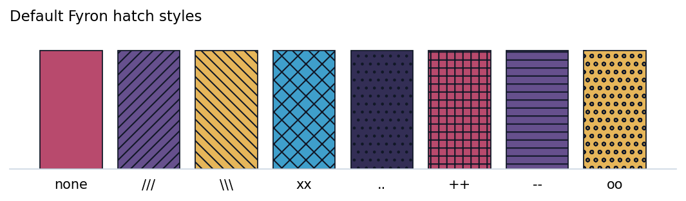

# Clinical Plotting

The [survival workflow](../survival-workflow.md) demonstrates the recommended `fyron.plotting` entry point. Existing survival plotting imports remain supported and share the same implementation.

Fyron's clinical plotting helpers are exposed through the dedicated `fyron.plotting` facade. They remain plain Matplotlib functions, so every figure can be saved, customized, combined into panels, or audited through returned tables.

Use these plots to explain clinical data science decisions: survival differences, model discrimination, calibration, thresholds, cohort flow, biomarker distributions, correlations, and manuscript-ready effect estimates.

## Use This Page For

| Need | Start here |
| --- | --- |
| Choose colors for manuscript figures | [Scientific Palettes And Styles](#scientific-palettes-and-styles) |
| Make bars readable without color | [Hatch And Schraffierung Styles](#hatch-and-schraffierung-styles) |
| Add p-value brackets or stars | [Statistical Annotations](#statistical-annotations) |
| Plot time-to-event endpoints | [Kaplan-Meier Curves](#kaplan-meier-curves) |
| Compare model and cohort outputs | [Plot Families](#plot-families) |
| Browse generated examples | [Visual Figure Gallery](../examples/visual-figure-gallery.md) |

For CT/MR slice comparison figures, use [BOA Visualization](visualization.md#volume-difference-heatmaps). Those helpers validate image geometry and return slice-level difference summary tables.

## Install

```bash
uv add "fyron[ml]"
uv add "fyron[survival]"
```

## Import

```python
from fyron import plotting as fp
```

Existing imports continue to work:

```python
from fyron import ml
from fyron.survival import plot_kaplan_meier
```

## Core Concepts

| Concept | Meaning |
| --- | --- |
| `fig, ax` | Standard Matplotlib figure and axes returned by most plotting helpers. |
| result object | Some workflow plots, such as Kaplan-Meier, return a named object with figure, axes, and computed statistics. |
| `save_path` | Optional file path for writing the figure directly. |
| `fmt` | Optional output format when saving, such as `png`, `pdf`, or `svg`. |
| `group_col` / `hue` | Clinical grouping variables used to stratify curves, boxes, bars, or densities. |
| `title`, `xlabel`, `ylabel` | Explicit labels for manuscript-ready figures. |

## API Contract

| Topic | Contract |
| --- | --- |
| Input shape | Arrays, result dictionaries, or DataFrames depending on the plot family. |
| Required columns | Named x/y/group/hue/time/event/metric columns must exist when using DataFrame plotting helpers. |
| Return shape | Usually `(fig, ax)`; table-backed plots return `(fig, ax, table)` or named result objects for survival plots. |
| Saved artifacts | Figures via `save_path`, plus returned audit tables for statistics, correlations, annotations, and summary plots. |
| Failure modes | Missing columns, invalid palette/colormap names, mismatched lengths, unavailable optional survival extras, cramped labels requiring figure-size adjustment, or inappropriate statistical tests. |

## Plotting Philosophy

Clinical figures often need to be clear in slides, manuscripts, and grayscale printouts. Fyron therefore:

- uses Matplotlib, avoiding a large plotting stack,
- returns figure and axes objects for downstream customization,
- supports `save_path` on plotting functions,
- includes hatch patterns for grouped bar plots,
- defaults categorical plots to the colorblind-safe Okabe-Ito palette,
- keeps BOARISK/Bits & Flames colors available as named palettes such as `bf`, `bf_vibrant`, and `bf_vibrant_muted`,
- defaults correlation plots to Spearman for clinical exploratory work,
- includes grouped boxplots with patient-level jitter for cohort and hue comparisons,
- includes smoothed density plots for distributions by event, treatment, or risk group,
- includes grouped bar plots with statistical significance notation for manuscript summaries,
- includes Kaplan-Meier curves for clinical time-to-event endpoints,
- includes calibration and precision-recall plots, not only ROC curves.

## Clinical Figure Preview

All previews below use synthetic data. They demonstrate figure layout, palette choice, and export style rather than clinical results.

<div class="bf-figure-gallery">
<figure class="bf-figure-card">

<figcaption><strong>Kaplan-Meier</strong>Survival curves with at-risk counts using <code>palette="okabe_ito"</code>.</figcaption>
</figure>
<figure class="bf-figure-card">

<figcaption><strong>Grouped Boxplot</strong>Continuous biomarker comparison with patient-level points and statistical annotation.</figcaption>
</figure>
<figure class="bf-figure-card">

<figcaption><strong>Correlation Heatmap</strong>Spearman feature correlation using <code>cmap="fyron_diverging_teal_orange"</code>.</figcaption>
</figure>
<figure class="bf-figure-card">

<figcaption><strong>Patterned Bar</strong>Endpoint rates using <code>palette="bf_vibrant_muted"</code> and explicit hatches.</figcaption>
</figure>
</div>

## Plot Selection Guide

| Question | Recommended plot |
| --- | --- |
| Can the model rank positives above negatives? | ROC curve, AUC |
| How does performance behave under class imbalance? | Precision-recall curve |
| Are predicted probabilities trustworthy? | Calibration curve |
| What mistakes occur at a threshold? | Confusion matrix |
| Do biomarker values differ across groups and subgroups? | Grouped boxplot |
| Do subgroup means/medians differ and need manuscript notation? | Grouped statistical bar plot |
| How does a continuous marker distribute by event or cohort? | Density plot |
| How do measurements compare with age or biological-age reference bands? | Reference band grid |
| Where do two continuous variables form dense clusters? | Filled KDE plot |
| Which features move together? | Correlation heatmap |
| Which features combine large effects with strong p-values? | Volcano plot |
| How do patient-level treatment durations and events unfold? | Swimmer plot |
| How do cohort members move across states or decisions? | Alluvial flow |
| How do discrete patient-feature marker bins compare? | Binned marker heatmap |
| How do event-free or overall survival curves differ by group? | Kaplan-Meier curve |
| Which model is best for a clinical metric? | Patterned metric bars |
| Do risk scores separate event groups? | Risk score distribution |
| Do marker distributions differ while preserving all patient points? | Raincloud plot |
| Which covariates increase or reduce risk? | Signed feature weights |
| Which endpoints/subgroups are statistically strongest? | Significance bars |
| What is the estimate and uncertainty per subgroup? | Forest estimates |

## Function Summary

| Function | Use When | Returns |
| --- | --- | --- |
| `plot_roc_curve` | Binary model discrimination with probabilities | `(fig, ax)` |
| `plot_cross_validated_roc` | Discrimination across out-of-fold cross-validation predictions | `(fig, ax, table)` |
| `plot_precision_recall_curve` | Imbalanced binary endpoints where PPV/recall matter | `(fig, ax)` |
| `plot_calibration_curve` | Checking whether predicted probabilities match observed risk | `(fig, ax)` |
| `plot_confusion_matrix` | Reviewing TP/FP/FN/TN counts | `(fig, ax)` |
| `plot_kaplan_meier` | Visualizing time-to-event outcomes by group | `KaplanMeierPlotResult` |
| `plot_feature_importance` | Showing tree-model feature importances | `(fig, ax)` |
| `plot_grouped_boxplot` | Comparing continuous biomarkers across groups and hue categories | `(fig, ax)` or `(fig, ax, table)` |
| `plot_swarmplot` | Showing patient-level points across groups and hue categories | `(fig, ax)` or `(fig, ax, table)` |
| `plot_histogram` | Showing binned distributions by cohort or hue | `(fig, ax)` |
| `plot_grouped_bar_with_significance` | Grouped/hue bar summaries with p-value brackets and notation | `(fig, ax, table)` |
| `plot_density` | Showing smoothed distributions for a continuous marker | `(fig, ax)` |
| `plot_qq` | Checking observed quantiles against normal-theory quantiles | `(fig, axes, table)` |
| `plot_reference_band_grid` | Showing precomputed reference intervals across age, biological age, or another continuous axis | `(fig, axes)` |
| `plot_filled_kde` | Showing filled two-dimensional KDE contours by group | `(fig, ax)` |
| `plot_correlation_heatmap` | Exploring numeric feature relationships | `(fig, ax, corr_df)` |
| `plot_grouped_correlation_heatmaps` | Comparing correlation structures by subgroup | `(fig, axes, corr_df)` |
| `plot_missingness_bar` | Visualizing missingness summaries | `(fig, ax)` |
| `plot_feature_selection_summary` | Showing selected/rejected feature-selection results | `(fig, ax)` |
| `plot_stability_selection` | Showing stability-selection frequencies | `(fig, ax)` |
| `plot_bland_altman` | Agreement between two measurement methods | `(fig, ax)` |
| `plot_waterfall` | Ordered patient-level response or score-change values | `(fig, ax)` |
| `plot_table_one_summary` | Compact Table 1 p-value overview | `(fig, ax)` |
| `plot_survival_calibration` | Fixed-horizon observed versus predicted survival/event risk | `(fig, ax)` |
| `plot_decision_curve` | Decision-curve net benefit over thresholds | `(fig, ax)` |
| `plot_time_dependent_auc` | Precomputed time-dependent AUC values | `(fig, ax)` |
| `plot_cohort_flow` | CONSORT/STROBE-style cohort count flow | `(fig, ax)` |
| `plot_segmentation_overlay_grid` | Image/mask overlay grid for segmentation QC | `(fig, axes)` |
| `plot_dice_by_label` | Label-wise Dice score bars | `(fig, ax)` |
| `plot_external_validation_metrics` | External validation metric bars | `(fig, ax)` |
| `plot_patterned_bar` | Publication-safe grouped bars with hatches | `(fig, ax)` |
| `plot_metric_bars` | Comparing model metrics across models | `(fig, ax)` |
| `plot_likert_scale` | Reader-study, usability, or survey responses on ordered scales | `(fig, ax, table)` |
| `plot_waffle` | Cohort composition, endpoint mix, or class balance as unit squares | `(fig, ax, table)` |
| `plot_risk_score_distribution` | Showing score distributions by event/censoring group | `(fig, ax)` |
| `plot_signed_feature_weights` | Showing signed model coefficients or feature weights | `(fig, ax)` |
| `plot_significance_bars` | Showing p-values as `-log10(p)` bars | `(fig, ax, table)` |
| `plot_volcano` | Screening features by effect size and p-value | `(fig, ax)` |
| `plot_swimmer` | Patient-level treatment timelines with events | `(fig, ax)` |
| `plot_raincloud` | Distribution summaries with half-violin, box, and patient points | `(fig, ax)` |
| `plot_alluvial_flow` | Categorical transitions across ordered stages | `(fig, ax)` |
| `plot_binned_marker_heatmap` | Discrete patient-feature marker grids | `(fig, ax)` |
| `plot_directional_ratio_rows` | Showing odds or hazard ratios with protective/hazardous direction bands | `(fig, ax)` |
| `plot_forest_estimates` | Showing estimates with confidence intervals | `(fig, ax)` |
| `plot_hazard_ratios` | Plotting Cox hazard ratios from a Fyron Cox result | `(fig, ax)` |
| `get_palette` | Getting a named scientific palette as hex colors | list |
| `list_palettes` | Reviewing available palettes and safety metadata | DataFrame |
| `get_colormap` | Getting a named sequential/diverging Matplotlib colormap | colormap |
| `set_plot_style` | Applying Fyron paper/poster/minimal Matplotlib defaults | `None` |
| `preview_palette` | Rendering palette swatches for review | `(fig, ax)` |
| `palette_luminance_table` | Auditing luminance and text-color contrast | DataFrame |
| `palette_grayscale_contrast` | Checking adjacent grayscale differences | DataFrame |
| `stat_test_pairs` | Computing pairwise p-values for plot annotations | DataFrame |
| `add_stat_annotations` | Adding bracket annotations to categorical Matplotlib plots | `Axes` |
| `format_p_value_annotation` | Formatting p-values as stars or text | string |
| `plot_schoenfeld_residuals` | Cox proportional-hazards residual diagnostics | `(fig, ax)` from `fyron.survival` |

## Function Parameter Reference

| Function | Required | Optional | Returns |
| --- | --- | --- | --- |
| `plot_roc_curve` | `y_true`, `y_prob` | `title`, `ax`, `save_path`, `fmt`, `pos_label` | `(fig, ax)` |
| `plot_cross_validated_roc` | prediction table with `y_true`, `y_prob`, `fold` | column names, `mean_grid_points`, `palette`, `title`, save options | `(fig, ax, table)` |
| `plot_precision_recall_curve` | `y_true`, `y_prob` | `title`, `ax`, `save_path`, `fmt`, `pos_label` | `(fig, ax)` |
| `plot_calibration_curve` | `y_true`, `y_prob` | `n_bins`, `strategy`, `title`, `ax`, `save_path`, `fmt`, `pos_label` | `(fig, ax)` |
| `plot_confusion_matrix` | `y_true`, `y_pred` | `title`, `ax`, `save_path`, `fmt`, `pos_label` | `(fig, ax)` |
| `plot_kaplan_meier` | `df`, `duration_col`, `event_col` | `group_col`, `split_column`, CI/risk count/style/save/RMST options | `KaplanMeierPlotResult` |
| `plot_feature_importance` | importance table or model wrapper path | `top_n`, `title`, `ax`, `save_path`, `fmt` | `(fig, ax)` |
| `plot_grouped_boxplot` | `data`, `x`, `y` | `hue`, order, labels, palette, points, `comparisons`, `stat_test`, `p_adjust`, annotation options, `return_stats`, save options | `(fig, ax)` or `(fig, ax, table)` |
| `plot_swarmplot` | `data`, `x`, `y` | `hue`, orders, dodge, point style, `comparisons`, `stat_test`, `p_adjust`, annotation options, `return_stats`, save options | `(fig, ax)` or `(fig, ax, table)` |
| `plot_histogram` | `data`, `x` | `hue`/`group`, `bins`, `stat`, `multiple`, labels, palette, save options | `(fig, ax)` |
| `plot_grouped_bar_with_significance` | `data`, `x`, `y` | `hue`, orders, `estimator`, `error`, `test`, comparisons, notation thresholds, labels, save options | `(fig, ax, table)` |
| `plot_density` | `data`, `x` | `hue`, `hue_order`, labels, `palette`, `fill`, `alpha`, `rug`, `bandwidth`, `gridsize`, `ax`, `save_path`, `fmt` | `(fig, ax)` |
| `plot_qq` | vector data, `value_col`, or `columns` | `group_col`, normal-theory reference, line mode, facets, palette, labels, save options | `(fig, axes, table)` |
| `plot_reference_band_grid` | band table with `x`, `lower_col`, `upper_col`, `band_col`, and `col` | optional `row`, line overlay table, facet/band order, custom colors, labels, sharing, save options | `(fig, axes)` |
| `plot_correlation_heatmap` | `data` | `columns`, `method`, `group_col`, `title`, `annotate`, significance overlay, `mask_upper`, color scale, save options | `(fig, ax, corr_df)` or grouped output |
| `plot_grouped_correlation_heatmaps` | `data`, `group_col` | `columns`, `method`, annotation/significance options, color scale, save options | `(fig, axes, corr_df)` |
| `plot_missingness_bar` | missingness summary table | column/group/value column names, `title`, `ax`, `save_path`, `fmt` | `(fig, ax)` |
| `plot_feature_selection_summary` | feature-selection summary table | feature/selected/score columns, `top_n`, save options | `(fig, ax)` |
| `plot_stability_selection` | stability-selection table | feature/frequency columns, threshold, `top_n`, save options | `(fig, ax)` |
| `plot_bland_altman` | `method_a`, `method_b` | `title`, `ax`, `save_path`, `fmt` | `(fig, ax)` |
| `plot_waterfall` | `values` | labels, title, y label, threshold, save options | `(fig, ax)` |
| `plot_table_one_summary` | Table 1 long table with p-values | variable/p-value column names, save options | `(fig, ax)` |
| `plot_survival_calibration` | calibration bin table | observed/predicted column names, save options | `(fig, ax)` |
| `plot_decision_curve` | decision-curve table | threshold/model/treat-all/treat-none columns, save options | `(fig, ax)` |
| `plot_time_dependent_auc` | time/AUC table | time and AUC column names, save options | `(fig, ax)` |
| `plot_cohort_flow` | cohort flow table | step/count column names, save options | `(fig, ax)` |
| `plot_segmentation_overlay_grid` | 3D image and mask arrays | slice indices, label, alpha, save options | `(fig, axes)` |
| `plot_dice_by_label` | segmentation metric table | label and Dice column names, save options | `(fig, ax)` |
| `plot_external_validation_metrics` | metric dict or long table | metric/value column names, save options | `(fig, ax)` |
| `plot_patterned_bar` | `data`, `x`, `y` | `group`, `error`, labels, orientation, palette, hatches, `annotate`, `ax`, `save_path`, `fmt` | `(fig, ax)` |
| `plot_metric_bars` | `metrics` | `metrics_to_plot`, `model_col`, `title`, `ax`, `save_path`, `fmt` | `(fig, ax)` |
| `plot_likert_scale` | long table with `item` and `response` | `count_col`, ordering, neutral responses, normalization, palette, save options | `(fig, ax, table)` |
| `plot_waffle` | category/value table | column names, `total`, `rows`, palette, save options | `(fig, ax, table)` |
| `plot_risk_score_distribution` | `data` with `risk_col` | `event_col`, `event_labels`, `title`, `ylabel`, `jitter`, `violin`, `palette`, `random_state`, `ax`, `save_path`, `fmt` | `(fig, ax)` |
| `plot_signed_feature_weights` | `data` with `feature_col` and `weight_col` | `top_n`, `title`, `xlabel`, legend labels, `ax`, `save_path`, `fmt` | `(fig, ax)` |
| `plot_significance_bars` | `data` with `label_col` and `p_col` | `threshold`, `title`, `xlabel`, `annotate`, `ax`, `save_path`, `fmt` | `(fig, ax, table)` |
| `plot_volcano` | feature, effect, and p-value columns | group/color column, thresholds, top labels, palette, save options | `(fig, ax)` |
| `plot_swimmer` | patient, start, and end columns | group, event time/type columns, labels, palette, save options | `(fig, ax)` |
| `plot_raincloud` | group and numeric value columns | order, labels, palette, random state, save options | `(fig, ax)` |
| `plot_alluvial_flow` | path, stage, category, and value columns | stage order, palette, save options | `(fig, ax)` |
| `plot_binned_marker_heatmap` | row, column, and numeric bin columns | row/column order, colormap, missing color, save options | `(fig, ax)` |
| `plot_directional_ratio_rows` | `data` with `feature_col` and `ratio_col` | optional CI, p-value, group, n columns, OR/HR table headers, reference, log scale, x limits, annotations, save options | `(fig, ax)` |
| `plot_forest_estimates` | `data` with `label_col`, `estimate_col`, `lower_col`, `upper_col` | `p_col`, `p_adjust_col`, `n_col`, `group_col`, table columns, `reference`, `log_scale`, labels, save options | `(fig, ax)` |
| `plot_hazard_ratios` | Cox result or fitted Cox object | label/title/table/save options | `(fig, ax)` |
| `get_palette` | none | `name`, `n`, `reverse` | list |
| `list_palettes` | none | `kind` | DataFrame |
| `get_colormap` | none | `name`, `reverse` | Matplotlib colormap |
| `set_plot_style` | none | `style`, `palette` | `None` |
| `preview_palette` | `name` | `n`, `save_path` | `(fig, ax)` |
| `palette_luminance_table` | palette name or colors | none | DataFrame |
| `palette_grayscale_contrast` | palette name or colors | none | DataFrame |
| `stat_test_pairs` | `data`, `x`, `y`, `pairs` | `hue`, test, p-value correction, custom p-values, annotation format | DataFrame |
| `add_stat_annotations` | `ax`, `stats_table` | positions, heights, annotation column, style, inside/outside placement | `Axes` |
| `plot_schoenfeld_residuals` | Schoenfeld residual table | covariates, column names, save options | `(fig, ax)` |

## Parameter Notes

| Parameter | Practical guidance |
| --- | --- |
| `data` | Use a DataFrame with explicitly named clinical columns. |
| `y_true`, `y_pred`, `y_prob` | Use the same held-out set when comparing model evaluation plots. |
| `duration_col`, `event_col` | Survival plots expect positive durations and `1` event / `0` censored coding. |
| `group_col`, `hue`, `order`, `hue_order` | Set these explicitly for reproducible manuscript layouts. |
| `ax` | Pass an existing Matplotlib axis when composing multi-panel figures. |
| `save_path` | Use for direct artifact generation in scripts or CLI-like jobs. |

## Return Values

Most plotting functions return `(fig, ax)`. Some functions return `(fig, ax, table)` when the computed table is part of the result, such as statistical bar plots or correlation heatmaps. Kaplan-Meier functions return a result object with plot handles and survival statistics. Keep returned tables with exported figures so visual annotations can be audited.

## Scientific Palettes And Styles

Fyron uses named palettes so a study can keep the same visual language across notebooks, figures, slides, and supplements. The defaults follow scientific color guidance from [SciFig](https://scifig.ai/blog/color-palettes-scientific-figures), [Datawrapper](https://www.datawrapper.de/blog/colorguide), and [Molecular Ecologist](https://www.molecularecologist.com/2020/04/23/simple-tools-for-mastering-color-in-scientific-figures/): use qualitative colors for categories, sequential colors for ordered magnitude, and diverging colors when values have a meaningful midpoint. Avoid rainbow/jet maps for continuous data, keep categorical palettes small, and pair color with hatches, points, labels, or small multiples when a figure has many groups.

The default categorical palette is `okabe_ito`, a colorblind-safe palette widely used for scientific figures. BOARISK/Bits & Flames colors remain available as `palette="bf"`, `palette="bf_vibrant"`, and `palette="bf_vibrant_muted"` when brand continuity matters.

```python
from fyron import plotting as fp

fp.list_palettes()

fig, ax = fp.preview_palette("okabe_ito")
audit = fp.palette_luminance_table("okabe_ito")
contrast = fp.palette_grayscale_contrast("okabe_ito")

fp.set_plot_style(style="paper", palette="okabe_ito")
```

Use named palettes and colormaps directly in plotting functions:

```python
fig, ax = fp.plot_grouped_boxplot(
    clinical_features,
    x="risk_group",
    y="l3_sma_cm2",
    palette="okabe_ito",
)

km = fp.plot_kaplan_meier(
    cohort,
    duration_col="time",
    event_col="event",
    group_col="risk_group",
    palette="okabe_ito",
)

fig, ax, corr = fp.plot_correlation_heatmap(
    clinical_features,
    columns=["age", "tumor_volume", "risk_score"],
    cmap="fyron_diverging_blue_red",
)
```

Practical color rules:

- Use `okabe_ito` or `wong` for categorical clinical groups.
- Use `muted_scientific` or `nature_cool` for restrained journal-style categorical plots.
- Use `bf_vibrant_muted` for branded figures that should feel like Bits & Flames without overpowering manuscript layouts.
- Use `fyron_sequential_blue` or `fyron_sequential_teal` for ordered magnitude.
- Use `fyron_diverging_blue_red` or `fyron_diverging_teal_orange` for centered effects such as correlations, residuals, or signed changes.
- If a categorical palette needs more colors than recommended, Fyron warns. Consider hatches, marker shapes, faceting, or small multiples.
- Use external tools such as Viz Palette, Coblis, Sim Daltonism, or Datawrapper-style checks for full color-vision simulation before submission.

## Hatch And Schraffierung Styles

Schraffierungen make grouped figures more robust in grayscale, print, slide decks, and color-vision-sensitive settings. Use them when color alone would make groups hard to distinguish, especially for bar plots with multiple cohorts, endpoints, models, or scanner groups. For swarmplots, density plots, and line plots, prefer points, markers, direct labels, or small multiples instead of hatch patterns.

Fyron uses these default hatch styles:

| Position | Hatch |
| ---: | --- |
| 1 | none |
| 2 | `///` |
| 3 | `\\\` |
| 4 | `xx` |
| 5 | `..` |
| 6 | `++` |
| 7 | `--` |
| 8 | `oo` |



Use the `hatches=` parameter when you want to lock a specific visual language:

```python
from fyron import plotting as fp

fig, ax = fp.plot_patterned_bar(
    summary_df,
    x="endpoint",
    y="rate",
    group="cohort",
    error="ci_half_width",
    palette="bf_vibrant_muted",
    hatches=["", "///", "\\\\\\"],
    annotate=True,
    title="Endpoint rates by cohort",
)
```

`plot_metric_bars` builds on the same patterned-bar style, so model-comparison bars inherit black outlines, grouped hatches, and grayscale-safe visual separation. For manuscript figures, combine hatches with restrained palettes, black outlines, direct labels, and exported vector formats such as PDF or SVG.

## Statistical Annotations

Fyron includes a Matplotlib-native annotation layer inspired by [`trevismd/statannotations`](https://github.com/trevismd/statannotations). It keeps the useful manuscript behavior, including pairwise tests, multiple-testing correction, custom p-values, star labels, explicit p-value labels, and bracket layout, without adding Seaborn as a required dependency.

Use `stat_test_pairs` when you need the statistics table separately, and use `add_stat_annotations` when you already have an axis to annotate:

```python
stats = fp.stat_test_pairs(
    clinical_features,
    x="risk_group",
    y="risk_score",
    pairs=[("Low", "High")],
    test="mannwhitney",
    p_adjust="fdr_bh",
)

fp.add_stat_annotations(ax, stats)
```

For built-in categorical plots, prefer `return_stats=True` so the figure and its statistical audit table are produced together.

## Model Evaluation Plot Set

```python
from fyron import ml, plotting as fp

rf = ml.train_random_forest(
    X_train=X_train,
    y_train=y_train,
    X_test=X_test,
    y_test=y_test,
    n_estimators=300,
    random_state=42,
)

fig_roc, _ = fp.plot_roc_curve(
    y_true=y_test,
    y_prob=rf["y_prob"],
    title="Random Forest ROC",
)
fig_pr, _ = fp.plot_precision_recall_curve(
    y_true=y_test,
    y_prob=rf["y_prob"],
)
fig_cal, _ = fp.plot_calibration_curve(
    y_true=y_test,
    y_prob=rf["y_prob"],
    n_bins=10,
)
fig_cm, _ = fp.plot_confusion_matrix(
    y_true=y_test,
    y_pred=rf["y_pred"],
)
```

When `plot=True` is passed to `train_random_forest` or `train_xgboost`, these figures are created automatically:

```python
rf = ml.train_random_forest(
    X_train=X_train,
    y_train=y_train,
    X_test=X_test,
    y_test=y_test,
    n_estimators=300,
    random_state=42,
    plot=True,
)

rf["figures"].keys()
# dict_keys(["roc", "precision_recall", "calibration", "confusion_matrix"])
```

For cross-validation, pass a table of out-of-fold predictions instead of a fitted model. This keeps model fitting separate from figure generation and makes the AUC table easy to save with the manuscript supplement.

```python
cv_predictions = pd.DataFrame(
    {
        "fold": fold_ids,
        "y_true": y_true_oof,
        "y_prob": y_prob_oof,
    }
)

fig, ax, auc_table = fp.plot_cross_validated_roc(
    cv_predictions,
    title="Five-fold cross-validated ROC",
    palette="okabe_ito",
)
```

## Correlation Heatmap

Use a correlation heatmap for feature screening, redundancy checks, and sanity checks before modeling. Fyron uses `method="spearman"` by default because clinical variables are often skewed, ordinal, or monotonic without being normally distributed.

```python
fig, ax, corr = fp.plot_correlation_heatmap(
    data=clinical_features,
    columns=["age", "tumor_volume", "risk_score", "lab_value"],
    method="spearman",
    mask_upper=True,
    annotate_significance=True,
    p_adjust="fdr_bh",
    title="Feature correlation",
    cmap="fyron_diverging_teal_orange",
)
```

For subgroup analyses, use `group_col` or call `plot_grouped_correlation_heatmaps` directly:

```python
fig, axes, corr_long = fp.plot_grouped_correlation_heatmaps(
    data=clinical_features,
    group_col="treatment_arm",
    columns=["age", "tumor_volume", "risk_score", "lab_value"],
    annotate_significance=True,
    cmap="fyron_diverging_teal_orange",
)
```

Tips:

- Use `method="spearman"` for ordinal or non-linear monotonic relationships.
- Use `method="pearson"` when a linear relationship is the actual assumption.
- Use `mask_upper=True` to reduce visual duplication in large matrices.
- The returned `corr` DataFrame can be saved as a supplement table.

## Grouped Boxplots

Use grouped boxplots when the clinical question is about a continuous biomarker across discrete patient groups: L3 muscle area by risk group, creatinine by treatment arm, VAT by sex and cohort, or a model score by response category. Fyron draws each box with a black outline, restrained color fill, and optional patient-level jitter so outliers and sample size remain inspectable.

Required columns:

- `x`: categorical group column such as risk group, treatment arm, sex, stage, or endpoint.
- `y`: numeric marker column such as `l3_sma_cm2`, `risk_score`, `vat_ml`, or `albumin`.

Common optional parameters:

- `hue`: second grouping column drawn side by side inside each `x` group.
- `order` and `hue_order`: explicit display order for manuscript-ready figures.
- `show_points`: overlay patient-level jittered observations.
- `palette`: custom color sequence.

```python
fig, ax = fp.plot_grouped_boxplot(
    data=clinical_features,
    x="risk_group",
    y="l3_sma_cm2",
    hue="sex",
    order=["Low", "Intermediate", "High"],
    hue_order=["Female", "Male"],
    title="L3 skeletal muscle area by risk group",
    ylabel="L3 SMA (cm2)",
    palette="okabe_ito",
)
```

Add statannotations-style brackets when the figure needs explicit comparisons. Fyron computes the tests with SciPy, applies Fyron p-value correction, and returns the audit table when `return_stats=True`.

```python
fig, ax, stats = fp.plot_grouped_boxplot(
    data=clinical_features,
    x="risk_group",
    y="l3_sma_cm2",
    comparisons=[("Low", "High")],
    stat_test="mannwhitney",
    p_adjust="fdr_bh",
    annotation_format="star",
    return_stats=True,
    palette="okabe_ito",
)
```

For small and medium cohorts, keep `show_points=True` so readers can see how many observations drive each box. For very large cohorts, set `show_points=False` and consider a density plot next to the boxplot.

## Statistical Grouped Bar Plots

Use statistical grouped bar plots when the manuscript needs compact mean or median summaries with explicit significance notation. Fyron draws grouped/hue bars with black outlines, optional error bars, and bracket annotations. The returned table includes one row per plotted summary plus one row per statistical comparison, so the visual notation can be audited.

Defaults:

- `estimator="mean"` and `error="sem"`.
- `test="auto"` uses Mann-Whitney U for pairwise group comparisons.
- `hue` with two levels compares hue levels inside each `x` group.
- two `x` groups without hue compare the two x groups directly.
- notation defaults to `***`, `**`, `*`, and `ns`.

```python
fig, ax, stats_table = fp.plot_grouped_bar_with_significance(
    data=clinical_features,
    x="risk_group",
    y="l3_sma_cm2",
    hue="sex",
    estimator="mean",
    error="sem",
    title="L3 skeletal muscle area by risk group and sex",
    ylabel="L3 SMA (cm2)",
)
```

For small cohorts, pair this plot with a grouped boxplot or density plot so readers can inspect the distribution behind the summary bars.

## Density Plots

Density plots are helpful when a boxplot hides the actual shape of the distribution. Use them to compare risk scores between event and non-event patients, lab values between treatment arms, or imaging markers between anatomical subgroups. Fyron uses a lightweight NumPy Gaussian kernel density estimate, so no Seaborn or SciPy dependency is required.

Required columns:

- `x`: numeric marker or score column.

Common optional parameters:

- `hue`: categorical column for separate curves.
- `hue_order`: explicit curve order.
- `fill`: fill the area below each curve.
- `rug`: show patient-level tick marks along the baseline.
- `bandwidth`: custom smoothing bandwidth when the automatic rule is too smooth or too jagged.
- `gridsize`: number of x-axis evaluation points.

```python
fig, ax = fp.plot_density(
    data=clinical_features,
    x="risk_score",
    hue="event",
    hue_order=[0, 1],
    title="Risk score density by event status",
    xlabel="Predicted risk score",
    rug=True,
    palette="okabe_ito",
)
```

Interpret density plots as distribution summaries, not counts. If absolute group size matters in the figure, use `plot_histogram`; if each patient-level value should remain visible, use `plot_swarmplot`.

Use `plot_filled_kde` for the two-dimensional version, similar to `sns.kdeplot(..., x=..., y=..., hue=..., fill=True)`:

```python
fig, ax = fp.plot_filled_kde(
    data=geyser_like,
    x="waiting",
    y="duration",
    hue="kind",
    fill=True,
    title="Waiting time and duration density",
    xlabel="Waiting time",
    ylabel="Duration",
    palette="okabe_ito",
)
```

Filled KDE plots summarize where two variables are jointly dense. Use `show_points=True` while reviewing small cohorts, and tune `bandwidth` or `thresh` if clinically relevant subclusters are hidden.

```python
fig, ax = fp.plot_histogram(
    clinical_features,
    x="risk_score",
    hue="event",
    stat="percent",
    multiple="dodge",
    palette="okabe_ito",
)

fig, ax, stats = fp.plot_swarmplot(
    clinical_features,
    x="risk_group",
    y="risk_score",
    hue="sex",
    comparisons=[(("High", "Female"), ("High", "Male"))],
    return_stats=True,
    palette="okabe_ito",
)
```

## Validation And QC Plots

These plots consume tables produced by `fyron.validation`, `fyron.reporting`, or `fyron.imaging.segmentation`.

```python
from fyron import plotting as fp

fig_cal, _ = fp.plot_survival_calibration(calibration_bins)
fig_dca, _ = fp.plot_decision_curve(decision_curve)
fig_flow, _ = fp.plot_cohort_flow(flow_table)
fig_dice, _ = fp.plot_dice_by_label(segmentation_metrics)
fig_ext, _ = fp.plot_external_validation_metrics(
    {"auc": 0.81, "sensitivity": 0.74, "specificity": 0.69}
)
```

When inclusion and exclusion filters are executed in code, generate the count table with `fyron.flow` and pass it directly to `plot_cohort_flow`:

```python
from fyron.flow import FlowTracker
from fyron import plotting as fp

flow = FlowTracker("NSCLC CT cohort")
flow.add_step("Source cohort", raw)
flow.add_step("Has baseline CT", with_ct, reason="missing CT")

fig, ax = fp.plot_cohort_flow(flow.to_dataframe())
```

For segmentation visual QC:

```python
fig, axes = fp.plot_segmentation_overlay_grid(
    image=ct_array,
    mask=label_map,
    slice_indices=[40, 60, 80],
    label=5,
)
```

## Kaplan-Meier Curves

Kaplan-Meier curves belong in the clinical plotting toolkit because many cohort studies, imaging biomarkers, and risk scores are evaluated against time-to-event endpoints. You can call them through `fyron.plotting.plot_kaplan_meier` with the other clinical plots; internally the function delegates to `fyron.survival` because it fits Kaplan-Meier estimators, computes log-rank comparisons, and can annotate restricted mean survival time.

Required columns:

- `duration_col`: positive follow-up time.
- `event_col`: event indicator where `1` means event and `0` means censored.

Common optional columns and parameters:

- `group_col`: categorical group such as stage, treatment, or risk group.
- `split_column`: continuous score to split into median, tertile, quartile, or custom groups.
- `at_risk_counts`: add an at-risk count table below the plot.
- `at_risk_rows`: use `["at_risk"]` for only the at-risk row, `["at_risk", "events"]` for selected variants, or `"all"` for at-risk, censored, and event rows.
- `show_censors`: show censoring ticks.
- `xlim`: limit the time axis for a prespecified follow-up horizon.
- `reference_bands`: draw precomputed survival reference intervals behind the KM curves.
- `reference_band_preset`: use predefined labels/colors such as `"survival"`, `"risk"`, or `"percentile"`.
- `annotate_logrank`: add the log-rank p-value to the plot.
- `annotate_rmst`: annotate restricted mean survival time when configured.

```python
from fyron import plotting as fp

km = fp.plot_kaplan_meier(
    df=cohort,
    duration_col="time",
    event_col="event",
    group_col="risk_group",
    at_risk_counts=True,
    at_risk_rows=["at_risk"],
    show_censors=True,
    annotate_logrank=True,
    xlim=(0, 60),
    title="Overall survival by risk group",
    figsize=(7, 4),
    palette="okabe_ito",
)

km.figure.savefig("figures/km_risk_group.png", bbox_inches="tight")
km.logrank
km.n_per_group
```

Use reference bands when KM curves should sit in clinical context rather than on a blank survival-probability axis. The bands can represent historical controls, bootstrap percentile corridors, or manually defined favorable/intermediate/poor zones:

```python
km = fp.plot_kaplan_meier(
    df=cohort,
    duration_col="time",
    event_col="event",
    group_col="treatment",
    reference_bands=survival_reference_bands,
    reference_band_preset="survival",
    reference_band_alpha=0.28,
    confidence_interval=False,
    title="Overall survival with reference bands",
)
```

Use `split_column` when you have a continuous score and want Fyron to create the groups before plotting:

```python
km = fp.plot_kaplan_meier(
    df=cohort,
    duration_col="time",
    event_col="event",
    split_column="risk_score",
    split_method="quartile",
    at_risk_counts=True,
    title="Overall survival by risk-score quartile",
    palette="okabe_ito",
)
```

For full survival modeling details, see [Survival Analysis](survival.md).

## Plot Families

The BOARISK papers use a compact visual language: light grids, black outlines, restrained colors, and hatches so grouped figures remain readable in grayscale. Fyron exposes the same language in general-purpose functions for clinical data science.

<div class="bf-figure-gallery">
<figure class="bf-figure-card">

<figcaption><strong>Risk Score Distribution</strong><code>palette="bf_vibrant_muted"</code> with patient-level jitter and restrained violin fill.</figcaption>
</figure>
<figure class="bf-figure-card">

<figcaption><strong>Signed Feature Weights</strong>Risk-increasing and risk-reducing effects with directional hatches.</figcaption>
</figure>
<figure class="bf-figure-card">

<figcaption><strong>Significance Bars</strong><code>-log10(p)</code> summary bars for screening and supplement figures.</figcaption>
</figure>
<figure class="bf-figure-card">

<figcaption><strong>Directional Ratio Rows</strong>Odds or hazard ratios with protective left and hazardous right bands.</figcaption>
</figure>
<figure class="bf-figure-card">

<figcaption><strong>Forest Estimates</strong>Ratio estimates with confidence intervals and compact labels.</figcaption>
</figure>
<figure class="bf-figure-card">

<figcaption><strong>Q-Q Plot</strong>Normal-theory quantile diagnostics for residuals, biomarkers, and scores.</figcaption>
</figure>
<figure class="bf-figure-card">

<figcaption><strong>Reference Band Grid</strong>Precomputed clinical reference intervals across age, biological age, or another continuous axis.</figcaption>
</figure>
</div>

### Q-Q Plots

Use `plot_qq` when you need to check whether residuals, biomarkers, model scores, or continuous clinical measurements are compatible with normal-theory quantiles. Points close to the reference line indicate approximate agreement with the chosen theoretical distribution. Curvature, separated tails, or isolated points suggest skewness, heavy tails, outliers, or mixed subgroups.

Supported inputs:

- a vector, Series, or single-column DataFrame,
- a DataFrame plus `value_col`,
- multiple numeric DataFrame columns via `columns`,
- grouped overlays or facets through `group_col` and `facet=True`.

Reference line options are `"quartile"` for a robust Q1/Q3 line, `"fit"` for a least-squares line, `"identity"` for a 45-degree line, and `None` for points only. Version 1 supports `theoretical="normal"` without adding SciPy as a required plotting dependency.

```python
from fyron import plotting as fp

fig, axes, qq_table = fp.plot_qq(
    residuals_df,
    value_col="residual",
    group_col="cohort",
    line="quartile",
    title="Residual Q-Q plot",
    ylabel="Observed residual quantiles",
)
```

### Reference Band Grids

Use `plot_reference_band_grid` when you already have normative or risk-band intervals and want a compact panel plot across features and groups. This is useful for body-composition curves by age and sex, biological-age groups, lab reference ranges, imaging biomarkers, or radiomics feature bands.

Fyron only visualizes the provided intervals. It does not estimate SD or percentile curves internally, so the statistical meaning of each band stays explicit in your input table.

Required columns:

- `x`: continuous axis such as age, biological age, follow-up month, or dose.
- `lower_col` and `upper_col`: numeric interval bounds.
- `band_col`: interval label, for example `Below -1 SD`.
- `col`: feature or panel column, for example `ASAT`, `VAT`, or `Muscle`.

Optional inputs:

- `row`: second facet such as sex, cohort, modality, scanner, or age-group family.
- `line_df` with `line_y`: central, observed, fitted, or cohort trend line.
- `band_preset`: predefined band groups: `"sd"`, `"survival"`, `"risk"`, or `"percentile"`.
- `feature_order`, `row_order`, and `band_order`: reproducible panel and legend order.
- `band_colors`: custom mapping or color sequence.

```python
from fyron import plotting as fp

fig, axes = fp.plot_reference_band_grid(
    bands_df,
    x="age",
    lower_col="lower",
    upper_col="upper",
    band_col="band",
    col="feature",
    row="sex",
    line_df=median_df,
    line_y="value",
    feature_order=["ASAT", "GFAT", "VAT", "Muscle", "Liver Fat"],
    row_order=["Male", "Female"],
    band_preset="sd",
    xlabel="Age (years)",
    ylabel="Value",
    title="Body composition reference bands",
)
```

### Risk Score Distribution

Use this when you have a risk score, model score, or survival risk output and want to see whether event-positive patients are shifted toward higher values. It accepts a plain table and can draw one combined distribution or separate groups by `event_col`.

Required columns:

- `risk_col`: numeric score column.

Optional columns and parameters:

- `event_col`: grouping column, usually `0` for censored/non-event and `1` for event.
- `event_labels`: mapping or sequence used to replace group labels.
- `jitter`: overlay patient-level points.
- `violin`: use violin distributions; set to `False` for box plots.

```python
import pandas as pd
from fyron import plotting as fp

risk_df = pd.DataFrame(
    {
        "risk_score": [0.12, 0.24, 0.35, 0.61, 0.72, 0.89],
        "event": [0, 0, 0, 1, 1, 1],
    }
)

fig, ax = fp.plot_risk_score_distribution(
    data=risk_df,
    risk_col="risk_score",
    event_col="event",
    event_labels={0: "Censored", 1: "Event"},
    title="Risk score by event status",
    palette="bf_vibrant_muted",
)
```

### Signed Feature Weights

Use this for Cox coefficients, logistic regression coefficients, SHAP-like signed summaries, or any model output where positive values push risk upward and negative values push risk downward.

Required columns:

- `feature_col`: feature or covariate name.
- `weight_col`: signed numeric weight.

Optional parameters:

- `top_n`: keep the largest absolute weights.
- `positive_label` and `negative_label`: legend labels for interpretation.

```python
coef_df = pd.DataFrame(
    {
        "feature": ["L3 SMA", "VAT", "Age", "Albumin", "Tumor volume"],
        "coef": [-0.42, 0.38, 0.29, -0.31, 0.67],
    }
)

fig, ax = fp.plot_signed_feature_weights(
    data=coef_df,
    feature_col="feature",
    weight_col="coef",
    top_n=5,
    title="Top signed Cox coefficients",
)
```

### Significance Bars

Use this for log-rank results, subgroup tests, univariate screening, or endpoint comparisons. The plot converts p-values to `-log10(p)` so smaller p-values are visually stronger. It also returns the computed table with `minus_log10_p`.

Required columns:

- `label_col`: endpoint, subgroup, feature, or comparison name.
- `p_col`: p-value column.

Optional parameters:

- `threshold`: significance threshold drawn as a dashed line.
- `annotate`: show readable p-value labels next to bars.

```python
p_values = pd.DataFrame(
    {
        "comparison": ["L3 SMA", "VAT", "Albumin", "Age"],
        "p_value": [0.003, 0.048, 0.021, 0.19],
    }
)

fig, ax, table = fp.plot_significance_bars(
    data=p_values,
    label_col="comparison",
    p_col="p_value",
    threshold=0.05,
    title="Log-rank screening",
)
```

### Directional Ratio Rows

Use this for odds ratios, hazard ratios, or risk ratios when the direction matters as much as the estimate. Ratios below `1.0` are shown on the protective side, ratios above `1.0` on the hazardous side, and each feature receives one row.

Required columns:

- `feature_col`: feature, biomarker, subgroup, or covariate name.
- `ratio_col`: numeric odds ratio, hazard ratio, or risk ratio.

Optional columns:

- `lower_col` and `upper_col`: confidence interval bounds.
- `p_col`: p-value annotation.
- `group_col`: category prefix for row labels.
- `n_col`: sample size appended to row labels.

The right-side information table is optional. Keep `annotate=True` to show estimate, `95% CI`, and `p value` columns; set `annotate=False` for a pure visual ratio plot. Fyron infers `HR`, `OR`, or `RR` from `ratio_label`, and you can override the headers with `estimate_label`, `ci_label`, and `p_label`.

```python
ratio_df = pd.DataFrame(
    {
        "feature": ["Sarcopenia", "High VAT", "Albumin", "Stage IV"],
        "category": ["Body composition", "Body composition", "Laboratory", "Clinical"],
        "hazard_ratio": [1.78, 1.41, 0.68, 2.16],
        "ci_lower": [1.18, 1.03, 0.49, 1.44],
        "ci_upper": [2.68, 1.94, 0.94, 3.24],
        "p_value": [0.006, 0.031, 0.018, 0.0004],
    }
)

fig, ax = fp.plot_directional_ratio_rows(
    data=ratio_df,
    feature_col="feature",
    ratio_col="hazard_ratio",
    lower_col="ci_lower",
    upper_col="ci_upper",
    p_col="p_value",
    group_col="category",
    ratio_label="Hazard ratio",
    estimate_label="HR",
    ci_label="95% CI",
    p_label="p value",
    title="Feature-level hazard ratios",
)
```

### Forest Estimates

Use this for Cox hazard ratios, odds ratios, risk ratios, subgroup analyses, or any estimate with lower and upper confidence bounds. Fyron defaults to a log x-axis because ratios are usually easier to read that way.

Required columns:

- `label_col`: row label.
- `estimate_col`: point estimate.
- `lower_col`: lower confidence interval.
- `upper_col`: upper confidence interval.

Optional columns:

- `p_col`: p-value annotation.
- `p_adjust_col`: adjusted p-value column when you want FDR-aware labels.
- `n_col`: sample size appended to the row label.
- `table_columns`: append estimate, CI, and p-value text to the y-axis labels.

```python
forest_df = pd.DataFrame(
    {
        "subgroup": ["Low sarcopenia", "Intermediate", "High sarcopenia"],
        "hazard_ratio": [0.82, 1.0, 1.74],
        "ci_lower": [0.52, 0.73, 1.15],
        "ci_upper": [1.29, 1.37, 2.61],
        "p_value": [0.37, 0.99, 0.008],
        "n": [118, 142, 96],
    }
)

fig, ax = fp.plot_forest_estimates(
    data=forest_df,
    label_col="subgroup",
    estimate_col="hazard_ratio",
    lower_col="ci_lower",
    upper_col="ci_upper",
    p_col="p_value",
    n_col="n",
    title="Overall survival subgroup effects",
    xlabel="Hazard ratio",
    table_columns=True,
)
```

For a Fyron Cox result, use the Cox-specific convenience wrapper:

```python
cox = fit_multivariate_cox(
    cohort,
    duration_col="time",
    event_col="event",
    covariates=["age", "stage", "risk_score"],
)

fig, ax = fp.plot_hazard_ratios(cox, title="Cox model hazard ratios")
```

## Likert Scale Plots

Use `plot_likert_scale` for reader studies, usability surveys, annotation review, or clinical expert ratings. The input should be a long table with one row per response, or one row per response category with a count column.

```python
fig, ax, likert_table = fp.plot_likert_scale(
    data=reader_survey,
    item_col="item",
    response_col="response",
    count_col="count",
    response_order=[
        "Disagree",
        "Neutral",
        "Agree",
        "Strongly agree",
    ],
    neutral_values=["Neutral"],
    palette="okabe_ito",
    title="Reader study agreement",
)
```

The returned table contains `count`, `percent`, `side`, and `plot_value`, so the plotted values can be exported with the figure.

## Waffle Plots

Use `plot_waffle` for simple cohort composition, class balance, endpoint mix, or review status summaries. Waffle plots are strongest when the categories are few and the total has an intuitive interpretation, such as 100 squares.

```python
fig, ax, waffle_table = fp.plot_waffle(
    data=cohort_mix,
    category_col="category",
    value_col="n",
    total=100,
    rows=10,
    palette="bf_vibrant_muted",
    title="Cohort composition",
)
```

The returned table includes source values, proportions, and allocated cell counts. For precise reporting, use the table values in text and the waffle plot as a visual summary.

## Patterned Bar Plot

Patterned bars are useful when groups need to remain distinguishable without color.

```python
fig, ax = fp.plot_patterned_bar(
    data=summary_df,
    x="endpoint",
    y="rate",
    group="cohort",
    error="ci_half_width",
    palette="bf_vibrant_muted",
    hatches=["", "///"],
    title="Endpoint rates by cohort",
    ylabel="Rate",
    annotate=True,
)
```

Expected input:

| endpoint | cohort | rate | ci_half_width |
| --- | --- | ---: | ---: |
| Response | Control | 0.31 | 0.05 |
| Response | Treatment | 0.46 | 0.06 |
| Toxicity | Control | 0.12 | 0.03 |
| Toxicity | Treatment | 0.18 | 0.04 |

## Model Metric Bars

`plot_metric_bars` accepts either a nested dictionary or a DataFrame.

```python
fig, ax = fp.plot_metric_bars(
    metrics={
        "Random Forest": rf["metrics"],
        "XGBoost": xgb["metrics"],
    },
    metrics_to_plot=["auc", "sensitivity", "specificity", "f1"],
    title="Model comparison",
)
```

This is a compact way to compare clinically meaningful metrics instead of focusing only on accuracy.

## Saving Figures

Every plotting helper accepts `save_path`.

```python
fp.plot_calibration_curve(
    y_true=y_test,
    y_prob=rf["y_prob"],
    save_path="figures/calibration_rf.png",
)
```

You can also use regular Matplotlib calls:

```python
fig, ax = fp.plot_roc_curve(
    y_true=y_test,
    y_prob=rf["y_prob"],
)
ax.set_title("Internal validation ROC")
fig.savefig("figures/roc_internal.svg", bbox_inches="tight")
```

## Choosing The Right Plot

| Question | Recommended plot |
| --- | --- |
| Can the model rank high-risk patients above low-risk patients? | ROC |
| Does the model perform well when the event is rare? | Precision-recall |
| Are predicted probabilities trustworthy as risk estimates? | Calibration |
| Which errors are clinically most common? | Confusion matrix |
| Are marker values different across clinical groups? | Grouped boxplot |
| Do score distributions have different shapes by cohort/event? | Density plot |
| Are features redundant or strongly associated? | Correlation heatmap |
| Do survival or event-free probability curves differ by group? | Kaplan-Meier |
| Which model has better sensitivity/specificity tradeoffs? | Metric bars |
| Do subgroup rates differ across endpoints? | Patterned bar plot |
| Are event patients visibly shifted to higher scores? | Risk score distribution |
| Which covariates push risk upward or downward? | Signed feature weights |
| Which tests pass a p-value threshold? | Significance bars |
| What are the effect estimates and confidence intervals? | Forest estimates |
