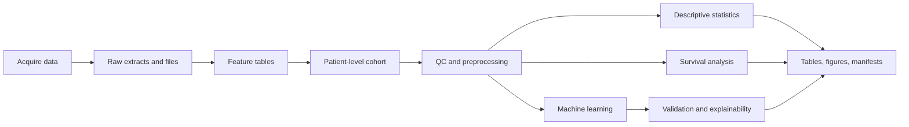

# Workflow Guide

Fyron is designed around transparent clinical data science steps: acquire data, shape it into patient-level feature tables, define a cohort and endpoint, run analysis, validate outputs, and publish artifacts. Real projects iterate, but each step should leave behind an inspectable artifact: raw extracts, cohort CSVs, feature tables, figures, model metrics, and provenance manifests.

The core idea is simple: keep clinical assumptions visible. If a function needs a duration column, event column, group column, feature matrix, or prediction probability, name it explicitly.

For a stricter research checklist with saved artifacts and reviewer-facing assumptions, see the [Clinical AI Study Workflow](clinical-ai-study-workflow.md).



## 1. Acquire Healthcare Data

Start with bounded, reproducible extracts. During exploration, keep page limits low and save raw outputs before transforming them.

| Source | Module | Typical artifact |
| --- | --- | --- |
| FHIR REST endpoint | `fyron.fhir.FHIRRestClient` | resource DataFrame |
| SQL-backed FHIR warehouse | `fyron.fhir.FHIRSQLClient` | query result DataFrame |
| DICOMweb | `fyron.dicom.DICOMDownloader` | DICOM/NIfTI files plus result table |
| PDFs/reports/files | `fyron.documents.DocumentDownloader` | downloaded files plus metadata |
| Existing CSV/Excel/JSON | `fyron.core` | normalized DataFrame |

```python
from fyron import FHIRRestClient

client = FHIRRestClient("https://hapi.fhir.org/baseR4")

conditions = client.search_df(
    "Condition",
    params={"_count": 50},
    max_pages=1,
)
```

For large FHIR result sets, use partitioned search instead of relying on endless pagination:

```python
conditions = client.search_df_partitioned(
    "Condition",
    partition_param="recorded-date",
    start="2020-01-01",
    end="2024-01-01",
    frequency="YS",
    params={"_count": 500},
    max_pages_per_partition=-1,
    deduplicate_by="id",
)
```

## 2. Derive Feature Tables

Feature tables should have one row per patient or per analysis unit. Keep names descriptive and preserve source identifiers when possible.

```python
features = observations.groupby("patient_id").agg(
    n_labs=("observation_id", "count"),
    max_marker=("marker_value", "max"),
).reset_index()
```

For imaging-derived features, BOA extraction already returns patient-level rows keyed by `download_id`:

```python
from fyron.boa_extraction import extract_boa_features

boa_features = extract_boa_features(
    "/data/boa-cohort",
    include_body_regions=True,
    include_total=True,
    num_workers=8,
)
```

## 3. Build The Cohort Contract

The cohort table is the contract between extraction and analysis. It should define the analysis unit, endpoint, follow-up, and covariates.

```python
from fyron.cohort import (
    build_survival_columns,
    join_cohort_tables,
    validate_cohort_table,
)

cohort = join_cohort_tables(
    features,
    outcomes,
    on="patient_id",
    how="inner",
)

cohort = build_survival_columns(
    cohort,
    start_col="index_date",
    end_col="last_followup_or_event_date",
    event_col="death_event",
    time_col="time",
    event_out_col="event",
)

validate_cohort_table(
    cohort,
    required_columns=["patient_id", "time", "event", "age", "risk_score"],
    id_column="patient_id",
)
```

Survival analyses expect `time > 0` and `event` coded as `1` for event and `0` for censored.

## 4. Check Analysis Readiness

QC should happen before modeling. Inspect duplicates, missingness, categorical levels, leakage signals, and split balance.

```python
from fyron import preprocessing as fp

missingness = fp.summarize_missingness(cohort, group_col="treatment_group")
duplicates = fp.find_duplicate_ids(cohort, id_col="patient_id")
levels = fp.summarize_categorical_levels(cohort, columns=["sex", "stage"])
leakage_flags = fp.detect_potential_leakage(cohort)
```

Typical decisions at this stage:

| Decision | Why it matters |
| --- | --- |
| Drop or impute missing values | Changes the analysis population and model inputs. |
| Encode categorical variables | Determines how models interpret stages, sex, scanner type, or treatment. |
| Remove leakage columns | Prevents post-outcome information from entering baseline models. |
| Stratify train/test split | Keeps outcome prevalence stable in imbalanced endpoints. |

## 5. Describe The Cohort

Descriptive outputs are usually the first result clinicians inspect.

```python
from fyron import descriptive as fd

table_one = fd.create_table_one(
    cohort,
    group_col="treatment_group",
    numeric=["age", "risk_score"],
    categorical=["sex", "stage"],
    include_smd=True,
)

endpoint = fd.summarize_endpoint(
    cohort,
    event_col="event",
    time_col="time",
    group_col="treatment_group",
)
```

Use standardized mean differences to understand balance. P-values alone are often misleading in baseline tables.

## 6. Analyze Survival Outcomes

Use Kaplan-Meier plots for descriptive group comparisons, RMST for absolute time summaries, and Cox/AFT models for adjusted analysis when assumptions are suitable.

```python
from fyron.survival import (
    calculate_rmst,
    fit_multivariate_cox,
    plot_kaplan_meier,
)

km = plot_kaplan_meier(
    cohort,
    duration_col="time",
    event_col="event",
    group_col="treatment_group",
    at_risk_counts=True,
)

cox = fit_multivariate_cox(
    cohort,
    duration_col="time",
    event_col="event",
    covariates=["age", "stage", "risk_score"],
)

rmst = calculate_rmst(
    cohort,
    duration_col="time",
    event_col="event",
    group_col="treatment_group",
    tau=365,
)
```

## 7. Train And Diagnose Classifiers

Use explicit feature matrices and labels. Clinical classification metrics should include sensitivity, specificity, balanced accuracy, AUC when probabilities are available, and confusion counts.

```python
from fyron import ml

X = cohort[["age", "stage_encoded", "risk_score", "max_marker"]]
y = cohort["binary_endpoint"]

result = ml.run_classification_pipeline(
    X,
    y,
    model="random_forest",
    handle_imbalance=True,
    random_state=42,
    n_estimators=300,
    plot=True,
)

result["metrics"]
result["figures"].keys()
```

## 8. Validate And Explain Models

Validation functions consume observed labels, predictions, probabilities, risk scores, or fixed-horizon survival predictions.

```python
from fyron import explainability as fe
from fyron import validation as fv

best_threshold = fv.find_best_threshold(y_test, result["y_prob"], metric="youden")
calibration, calibration_bins = fv.calibration_summary(y_test, result["y_prob"])
decision_curve = fv.decision_curve_table(y_test, result["y_prob"])

importance = fe.permutation_importance_table(
    result["model"],
    X_test,
    y_test,
    scoring="roc_auc",
)
```

Threshold scans are model-development information unless the threshold was pre-specified.

## 9. Create Tables, Figures, And Manifests

Use reporting and plotting helpers for paper-ready artifacts, then record provenance.

```python
from fyron import audit as fa
from fyron import plotting as fp
from fyron import reporting as fr

flow = fr.cohort_flow_table(
    [
        {"step": "Patients queried", "n": 1240},
        {"step": "With baseline CT", "n": 830, "reason": "missing CT"},
        {"step": "With complete outcome", "n": 790, "reason": "missing follow-up"},
    ]
)

fig, ax = fp.plot_cohort_flow(flow)

manifest = fa.create_provenance_manifest(
    title="Clinical model analysis",
    inputs=["data/cohort.csv"],
    outputs=["results/table_one.csv", "figures/km.png"],
    parameters={"duration_col": "time", "event_col": "event"},
)
fa.write_manifest(manifest, "results/provenance.json")
```

## Review Checklist

- The analysis unit is explicit.
- Raw source identifiers are preserved where useful.
- Cohort inclusion/exclusion is reproducible.
- `time` and `event` are built from documented date fields.
- Missingness and leakage are checked before modeling.
- Class imbalance handling is stated.
- Plots and tables have matching source parameters.
- A manifest travels with final artifacts.
